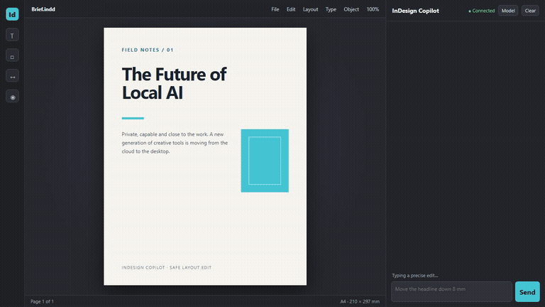

# InDesignAaronV1.1

An InDesign MCP server, portable skill runtime and in-app Copilot panel in one
Windows executable. It drives a live Adobe InDesign document through a UXP
plugin: inspect the layout, move and resize objects, edit text and styles, view
rendered pages, and verify every change — with reviewable plans and rollback.

Built on [theloniuser/indesign-uxp-server](https://github.com/theloniuser/indesign-uxp-server),
which forked [zachshallbetter/indesign-mcp-server](https://github.com/zachshallbetter/indesign-mcp-server)
(the AppleScript original) and moved execution inside InDesign via UXP.

## Demo

Simulated walkthrough of the included Copilot UI and safety workflow—not a live
InDesign recording. The editable source is in
[docs/assets/demo.html](docs/assets/demo.html).



[Watch the 28-second MP4](docs/assets/indesign-copilot-demo.mp4).

`InDesignAaronV1.1.exe` is the whole product:

- **MCP stdio server** — 136 low-level tools + 7 high-level skill tools for any
  MCP client (Claude Desktop, Cursor, Windsurf, custom clients).
- **Copilot bridge** — HTTP `127.0.0.1:3000` and WebSocket `127.0.0.1:3001`
  for the InDesign panel.
- **Portable skill catalog** — six skills with risk policy, approval,
  verification and rollback.
- **Direct view** — `preview_layout` renders pages to PNG and opens them in the
  system viewer so you can see the layout without leaving the chat.
- **Packaged UXP plugin** — the installer registers the production `.ccx`
  through Adobe UPIA; the manual flow can stage plugin sources with
  `--install-plugin`.

The same binary is both server and bridge, so there is no second process to
start and no Node installation required on the target machine.

---

## Requirements

- Windows 10/11 x64.
- Adobe InDesign 2023 (18.0) or newer with UXP plugin support. Launch InDesign
  once before setup so Creative Cloud can finish registering it.
- A trusted release installer for the normal path. Node.js, Adobe UXP
  Developer Tool, and manual MCP JSON editing are not end-user requirements.

## Quick start — signed per-user installer

1. Launch Adobe InDesign once.
2. From a trusted release, download and run
   `InDesignAaronV1.1-<version>-windows-setup.exe`. The current release pipeline
   emits the signed asset as
   `InDesignAaronV1.1-<version>-windows-setup-signed.exe`; use that signed file,
   not an `-unsigned.exe` developer build.
3. Accept the Windows and Adobe prompts. Setup installs per user under
   `%LOCALAPPDATA%\Programs\InDesignAaronV1.1`; it does not require administrator
   rights for the application.
4. Restart Claude Desktop, Cursor, or Qoder so the client reloads its MCP
   configuration.
5. Open InDesign **Window → Plugins → InDesign Copilot**.
6. In the panel's **Model** section, enter the model ID and API key, then send a
   message. API keys are held in memory for the active chat session, are sent
   only to the configured model endpoint, and are not saved by the panel or
   installer.

### What setup does

- Installs and starts the bridge, with a Startup shortcut for future sign-ins.
- Registers the packaged `.ccx` through Adobe's Unified Plugin Installer Agent
  (UPIA) when available.
- Configures detected MCP clients by merging only the `mcpServers.indesign`
  entry. Unrelated servers and top-level settings are preserved, and timestamped
  backups are kept when an existing file changes. If a client cannot be
  configured automatically, use the generated portable config as described
  below rather than replacing the client's whole config.
- Stores no model API keys in the installer, MCP config, plans, artifacts, or
  logs.

If UPIA is missing or rejects the package, setup copies an owned, exclusively
created `Install InDesign Copilot.ccx` (or a numbered variant) to the Desktop.
The plugin is **not installed yet** in that state: double-click the Desktop
`.ccx`, accept the Adobe trust prompt, wait for Creative Cloud to finish, then
restart InDesign. No UXP Developer Tool is needed for this fallback. If the
Desktop copy is missing, open
`%LOCALAPPDATA%\Programs\InDesignAaronV1.1\com.ads.indesign-bridge_ID.ccx`
manually.

A signed installer can still trigger Windows SmartScreen until the publisher
has established enough reputation. Continue only if you trust the release
source. This is separate from the Adobe plugin trust prompt and from model
credentials.

The build and source-contract tests do not establish public Authenticode trust,
UPIA installation on a clean target profile, or live InDesign panel operation;
those remain target-environment validation steps and are not claimed here.

## Use from an MCP client

The installer normally configures Claude Desktop, Cursor, and Qoder. Restart
the client after setup. If automatic configuration reports a problem, merge only
the `mcpServers.indesign` entry from:

```text
%LOCALAPPDATA%\Programs\InDesignAaronV1.1\mcp-config.json
```

into the client's existing MCP config. The usual files are:

```text
Claude Desktop: %APPDATA%\Claude\claude_desktop_config.json
Cursor:         %USERPROFILE%\.cursor\mcp.json
Qoder:          %USERPROFILE%\.qoder\mcp.json
```

Do not replace a client's whole config file, and restart the client after
editing it. For a manual executable setup, `--print-config` prints the exact
block to merge:

```powershell
.\InDesignAaronV1.1.exe --print-config
```

The client starts the executable without a terminal, so it runs in MCP mode and
also starts the bridge in-process. Only one process may own ports 3000/3001; if
you already ran `--bridge`, the server reuses it.

## MCP surface

### High-level skill tools

| Tool | Purpose |
|---|---|
| `inspect_layout` | Read-only snapshot: document, pages, items, styles, colors, layers, validation, fingerprint |
| `plan_edit` | Validate and version a structured edit plan; classify risk |
| `apply_edit_plan` | Revalidate, back up if high risk, apply, auto-rollback on failure |
| `verify_layout` | Structural checks plus optional visual review |
| `rollback_edit` | Reverse the journal or restore the guarded backup |
| `preview_layout` | Direct view: render pages to PNG and open the first one |
| `list_skills` | Show the skill catalog and allowed tools |

### Skills

`safe-layout-edit`, `text-typography-edit`, `align-distribute`,
`image-reframe`, `style-consistency`, `multi-page-consistency`.

Each is exposed as an MCP prompt (`indesign.safe_layout_edit`, …), as a
resource (`indesign://skills/<id>`), and as an Agent Skill in `skills/*.md`.
Skills forbid `execute_indesign_code`, `close_document`, `print_book` and
`package_document`, and each one lists exactly which low-level tools it may use.

### Low-level tools

143 tools in total: documents, pages, spreads, master spreads, text and tables,
styles, colors, graphics, layers, page items, groups, books, export and
utilities. The MCP client sees the same names as before this release.

## Workflow and safety

1. **Inspect** — `inspect_layout` returns `inspectionId` and a document
   fingerprint.
2. **Plan** — the model authors `targets` (pageIndex, itemIndex, before-state)
   and `steps` (tool + arguments). The server validates, normalizes and versions
   the plan and infers target fingerprints. A different plan version voids an
   approval.
3. **Classify** — low risk means one page, at most five existing targets, and
   only reversible allowlisted steps. Everything else is high risk and returns
   `approval_required`. The panel shows an approval card with the summary and
   affected pages. External MCP clients call `apply_edit_plan` with the same
   `planId` and `expectedVersion`; the server requests explicit human approval
   through MCP elicitation and authorizes the exact version server-side. Models
   cannot self-approve, and clients without elicitation support cannot apply
   high-risk plans.
4. **Apply** — the document is re-inspected immediately before execution; any
   change since inspection aborts with `STALE_PLAN`. High-risk plans first copy
   the saved `.indd` into the session artifact folder (a saved document is
   required).
5. **Verify** — structural checks always run and detect unexpected additions,
   removals, renames, overset text, out-of-bounds content, missing links/fonts
   and duplicate styles. Visual review is optional; without it the result is
   `structurally_checked_only`, never a full pass.
6. **Rollback** — low-risk plans replay inverse journal steps in reverse;
   high-risk plans restore the backup, and only if the document has not changed
   since the plan was applied (`ROLLBACK_CONFLICT` otherwise).

The original document is never saved automatically. API keys are sent only to
the model endpoint you configured and are never written to plans, artifacts or
logs.

### Optional bridge token

Set `BRIDGE_TOKEN` before starting to require
`Authorization: Bearer <token>` on `/execute`, `/chat` and `/status`:

```powershell
$env:BRIDGE_TOKEN = "a-long-random-string"
.\InDesignAaronV1.1.exe --bridge
```

Enter the same token in the panel's **Model** section. Without it the bridge is
open to any local process, which is fine on a single-user machine but not on a
shared one.

## Manual / developer setup

Use this flow when developing the plugin or running the portable executable
without the installer. It is not required for normal end-user setup.

1. Build or obtain `InDesignAaronV1.1.exe` and put it in a writable folder.
2. Stage the UXP plugin sources:

   ```powershell
   .\InDesignAaronV1.1.exe --install-plugin
   ```

   This writes `plugin\manifest.json`, `plugin\index.html`, and `plugin\index.js`
   next to the executable.
3. Open Adobe UXP Developer Tool → **Add Plugin** → choose that `manifest.json`
   → **Load**.
4. Start the bridge:

   ```powershell
   .\InDesignAaronV1.1.exe --bridge
   ```

   Leave that window open, then open InDesign **Window → Plugins → InDesign
   Copilot**. The panel reconnects automatically when the bridge is available.
5. Enter the model ID and API key in the panel's **Model** section. API keys are
   not persisted.
6. Merge the output of `.\InDesignAaronV1.1.exe --print-config` into the MCP
   client's existing config, preserving its other servers and settings.

When started with no arguments from a terminal, the executable prints help and
runs as a bridge. An MCP client starts it without a terminal, which selects MCP
stdio mode and starts the bridge in-process.

Check the installation at any time:

```powershell
.\InDesignAaronV1.1.exe --doctor
.\InDesignAaronV1.1.exe --print-config
```

For an explicit live check with InDesign open, run the self test. It waits for
the plugin to connect (60 seconds by default), inspects the open document, and
renders one page in the system image viewer:

```powershell
.\InDesignAaronV1.1.exe --selftest
.\InDesignAaronV1.1.exe --selftest --timeout 120
```

It exits with code 0 and prints the inspection ID and preview PNG paths when
both steps succeed, or code 1 with a `SELFTEST_TIMEOUT` / `SELFTEST_FAILED`
reason when they do not. This command requires a live plugin connection; the
automated suite and MCP smoke test do not perform live InDesign validation.

## Build from source / maintainer builds

Node.js 20+ is sufficient for source development, tests, and bundle-only work.
SEA executable, installer, and release builds require Node.js 24+ on Windows
x64. Installer builds also require Inno Setup 7 (or `INNO_SETUP_ISCC` pointing
to `ISCC.exe`). UXP packaging uses the pinned Adobe UXP CLI 1.2.0 dev dependency.
Signed releases additionally require SignTool and certificate or Azure Artifact
Signing credentials; see [CONTRIBUTING.md](CONTRIBUTING.md).

Use the script-free clean install because Adobe UXP CLI 1.2.0 has lifecycle
hooks that fail for consumers, then run the committed Adobe helper setup:

```powershell
npm ci --ignore-scripts
npm run prepackage:uxp
```

Run the maintainer checks and builds:

```powershell
npm test
npm run build
npm run smoke
npm run package:uxp
npm run build:installer
npm run build:release
```

- `npm run build` embeds the skill/plugin assets, bundles
  `build/indesign-aaron.cjs`, and builds `..\InDesignAaronV1.1.exe` with Node's
  Single Executable Application support.
- `npm run smoke` checks the built bundle's MCP stdio handshake. To check a
  different executable or bundle, use `npm run smoke -- <path>`.
- `npm run package:uxp` runs the Adobe helper prep step again and creates
  `dist/uxp/com.ads.indesign-bridge_ID.ccx`. It prefers the official CLI and
  uses Adobe's pinned offline package command only after an affirmative UXP
  Developer Service connection/unavailability diagnostic.
- `npm run build:installer` performs the SEA build, signs nothing, smoke-tests
  the SEA, packages the `.ccx`, compiles in temporary staging, and publishes
  `dist/installer/InDesignAaronV1.1-<version>-windows-setup-unsigned.exe` plus
  `mcp-config.json`.
- `npm run build:release` preflights signing inputs, signs and verifies the SEA
  and staged setup, and only then publishes
  `dist/installer/InDesignAaronV1.1-<version>-windows-setup-signed.exe`.
  It fails closed if signing or verification fails.

`npm start` runs the source server; `npm run bridge` runs the bridge alone;
`npm run dev` starts the source server with the Node inspector. The bundle is
`build/indesign-aaron.cjs`, so no external executable packer is needed.

Generated binaries and packages are intentionally excluded from Git. In-repo
`.exe`/`.ccx` files, `build/`, `dist/installer/`, portable installer configs,
and signing material are ignored; the SEA is written to
`..\InDesignAaronV1.1.exe`, outside the repository. Do not commit these outputs.
Regenerated embedded JavaScript under `src/assets/` is tracked source: review
and commit it when changing `skills/` or `plugin/`.

### Layout

```
src/core/            MCP server, tool dispatch, UXP executor
src/handlers/        ~136 low-level InDesign handlers
src/install/         MCP config merging, InDesign discovery, UPIA install/remove
src/skills/          catalog, plan schema, inspector, journal, backup, runtime, protocol
src/quality/         structural checks, page renderer, visual review, verifier
src/chat/            Copilot model adapters and tool loop
src/assets/          generated embedded skills and plugin files
bridge/server.js     HTTP + WebSocket relay (importable and standalone)
plugin/              Adobe UXP panel (chat, approval card, settings)
skills/              portable skill catalog (*.md + manifest.json)
scripts/             embed/build/package/smoke/sign pipelines
installer/           Inno Setup source and installed START-HERE guide
tests/               node --test suites
```

## Troubleshooting

- **Windows SmartScreen warns about the signed setup** — a valid signature does
  not immediately establish publisher reputation. Verify that the download came
  from a trusted release before continuing; do not use an unknown unsigned copy.
- **`Install InDesign Copilot*.ccx` appeared on the Desktop** — automatic UPIA
  registration did not complete, so the plugin is not installed yet. Double-click
  that `.ccx`, accept the Adobe trust prompt, wait for Creative Cloud, and restart
  InDesign. The installer chooses a numbered name rather than overwriting an
  existing file. If the Desktop copy is missing, open
  `%LOCALAPPDATA%\Programs\InDesignAaronV1.1\com.ads.indesign-bridge_ID.ccx`.
- **Panel says "Bridge off"** — for an installed copy, use the Start Menu
  shortcut **InDesign Copilot**; setup also creates a Startup shortcut. For a
  manual copy, run `InDesignAaronV1.1.exe --bridge`. The panel reconnects every
  3 seconds.
- **"Plugin not connected"** — complete any Desktop `.ccx` fallback first, then
  open **Window → Plugins → InDesign Copilot**. Use UXP Developer Tool only for
  the manual/developer flow. Run **Check Installation** in the Start Menu, or
  `InDesignAaronV1.1.exe --doctor`, to inspect InDesign discovery and whether the
  bridge reports a connected plugin.
- **Setup cannot find InDesign** — install InDesign 2023 (18.0) or newer, launch
  it once, and rerun setup. Detection uses registered App Paths and common Adobe
  install folders before copying application files.
- **MCP client does not show the server** — restart the client. If automatic
  configuration reported a problem, merge only `mcpServers.indesign` from
  `%LOCALAPPDATA%\Programs\InDesignAaronV1.1\mcp-config.json` into the existing
  client config; do not replace the whole file. `--print-config` provides the
  same block for a manual executable.
- **No document** — most tools need an open document; `create_document` is
  available if you want a new one.
- **High-risk plan needs a saved document** — save the `.indd` first so the
  backup can be made.
- **Ports busy** — stop the other bridge instance, or set `BRIDGE_TOKEN`
  consistently so both sides use the same configuration.
- **Visual review unavailable** — the configured model cannot accept images;
  the result is reported as structural-only.
- **Uninstall leaves the plugin listed** — use the **Uninstall InDesignAaronV1.1**
  Start Menu shortcut. If Creative Cloud still lists InDesign Copilot, open
  **Plugins → Manage Plugins** there and remove it. Uninstall removes only MCP
  entries owned by this installation and only unchanged Desktop fallback files
  recorded by setup.

## License

MIT. Original servers by zachshallbetter and theloniuser.
